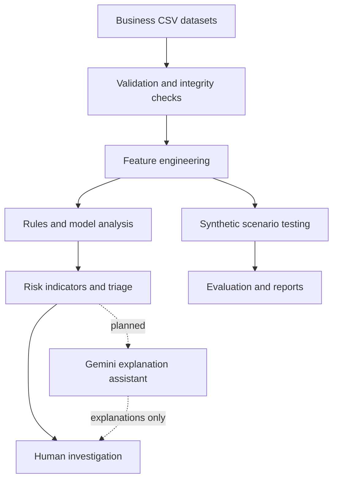

<div align="center">

# LAPE
### Leak Analysis & Prediction Engine

**From scattered business data to explainable risk signals.**

An analytics-first decision-support prototype for inspecting business records, surfacing unusual patterns, prioritizing cases, and helping people understand the evidence behind a flag.

**Datathon 2026 — Track 4: The Money Leak**

</div>

------------------------------------------------------------------------

## The pitch

Businesses rarely keep every useful clue in one place. A transaction can look ordinary on its own, while a pattern across transactions, inventory, campaigns, customers, and products may deserve a closer look. The challenge is not just finding an unusual record. It is making the signal understandable enough for someone to investigate it.

**LAPE turns business data into an investigation workflow.** It brings data validation, feature engineering, rule-based analysis, model-assisted evaluation, scenario testing, triage, and reporting into one Streamlit dashboard. The goal is to help a reviewer move from *"something looks unusual"* to *"here is what was flagged, why it matters, and what should be checked next."*

LAPE is a **screening and decision-support prototype**, not an automated verdict. A risk indicator is a reason to investigate, not proof that a loss, fraud, or causal relationship exists.

## Why LAPE?

- **One investigation workspace:** Move seamlessly between data quality, alerts, investigations, scenarios, evaluation, and reports.
- **Evidence over mystery scores:** Use computed features and transparent rules to make findings easy to inspect and audit.
- **Prioritized review:** Help reviewers decide which records deserve attention first with structured triage.
- **Repeatable testing:** Use synthetic scenarios to exercise the pipeline under controlled, reproducible conditions.
- **A path to explainable AI:** A planned Gemini-powered assistant will help users understand dashboard findings in plain language, without replacing the underlying analysis.

## What the prototype brings together

| Workspace | Purpose |
| :--- | :--- |
| **Overview** | Entry point to the analysis workflow and key system metrics. |
| **Data Quality** | Inspect input quality, schema constraints, and referential integrity. |
| **Alert Queue** | Review potential risk indicators prioritized by exposure, reliability, and urgency. |
| **Investigation** | Examine a selected case, supporting signals, and mathematical step-by-step formulas. |
| **Scenario Lab** | Explore generated scenarios, what-if conditions, and real-time physics simulations. |
| **Model Evaluation** | Review evaluation outputs, baseline comparisons, and operational limitations. |
| **Reports** | Prepare, preview, and export executive summaries of findings. |
| **Settings** | Manage user preferences, language selection, themes, and table layouts. |

The interface provides **dark and light themes** (`ui/themes.py`), **eight-language localization** (English, Hindi, Spanish, French, German, Japanese, Chinese, Russian via `ui/translations.py`), and **INR/USD currency formatting** (`src/currency.py`). These are interface capabilities, not claims about model performance.

### Local Reviewer Sandbox Credentials
For local reviewer and evaluator convenience:
- **Default Username:** `demo@lape.local` (or `admin`)
- **Default Password:** `lape2026`
- **Environment Override:** Set `LAPE_DEMO_USER` and `LAPE_DEMO_PASS` in your environment to override.
- *Includes a local arithmetic challenge (CAPTCHA) simulating authenticated access within an offline evaluation sandbox.*

## How LAPE works

1. **Load business tables.** Keep the source and intended use of each dataset clear.
2. **Validate the inputs.** Check structure, missing or invalid values, and referential data integrity.
3. **Engineer features.** Transform raw fields into indicators that can be examined and evaluated.
4. **Analyze signals.** Apply the verified mathematical rules and tree-based model logic implemented in the repository.
5. **Prioritize review.** Organize potential findings into an evidence-linked triage queue.
6. **Test scenarios.** Exercise the pipeline with generated synthetic cases.
7. **Evaluate and report.** Review available metrics, document limitations, and export summaries.



The Gemini connection shown with a dashed line is a **planned future enhancement**, not a claim that the API is already integrated.

## Data and evaluation: what the results mean

The application inspects five supplied CSV datasets in `DATASET/` (replicated in `data/raw/` with zero modifications to originals):

| Dataset Filename | Verified Row Count | Role in LAPE Pipeline | Integrity Findings |
| :--- | :--- | :--- | :--- |
| `transactions.csv` | 18,000 | Sales records, discounts, margins | 0 orphan keys; 6,829 negative margin sales ($1.21M shortfall) |
| `inventory.csv` | 5,000 | Stock levels, reorder thresholds | 0 orphan keys; 1,253 threshold vs stockout discrepancies |
| `campaigns.csv` | 1,200 | Marketing spend, impressions, clicks | 171 physical funnel inversions (clicks > impressions / conversions > clicks) |
| `customers.csv` | 3,000 | Customer profiles, return histories | 0 missing, 0 duplicates, 0 orphan references |
| `products.csv` | 250 | Catalog list prices and unit costs | 76 products with list price < unit cost (catalog cost inversion) |
| **Total Raw Data** | **27,450** | **Complete Multi-Table Business Baseline** | **0 Orphan Foreign Keys across all tables** |

In addition, `data/synthetic/lape_synthetic_scenarios.csv` contains 600 controlled test scenarios across 10 distinct anomaly families (`random_seed=42`) used for benchmark validation without modifying raw source data.

### Responsible interpretation

- **A flag is not a confirmed loss.** LAPE surfaces indicators for further investigation; exposure figures represent theoretical line-item maximums.
- **Synthetic evaluation is not real-world validation.** Strong scores on designed scenarios show performance on those scenarios only under controlled conditions.
- **Correlation is not causation.** A campaign and a transaction appearing in the same time window does not prove the campaign caused the transaction.
- **Exposure estimates are estimates.** Financial calculations depend on their documented formulas and assumptions.
- **Human review remains essential.** Verify source records, business context, and vendor contracts before acting.

### Verified Model Implementation
- **Primary Implemented Algorithm:** `HistGradientBoostingClassifier` (scikit-learn `sklearn.ensemble.HistGradientBoostingClassifier`) serialized in `models/lape_hist_gb.joblib`.
- **Benchmark Alternative Algorithm:** `RandomForestClassifier` serialized in `models/lape_random_forest.joblib`.
- **Target Leakage Prevention:** Scenario metadata (`injected_condition`, `expected_detection`) is strictly excluded from feature matrices.
- **Evaluation Split:** Grouped strictly by `source_record_id` ensuring zero overlap between training and held-out test splits.

## Planned feature: LAPE AI — Ask your business data

The next planned enhancement is an **AI tab powered by the Google Gemini API**. The vision is to let a user ask questions about the dashboard and receive explanations grounded in the analysis, rather than needing to understand every column, chart, or metric first.

Example questions for the planned assistant:

- *"Why was this record flagged?"*
- *"Explain these columns in simple business terms."*
- *"Summarize the strongest signals behind this alert."*
- *"What should I verify before treating this as a real issue?"*
- *"Compare these scenarios and explain what changed."*
- *"Summarize this report for a business stakeholder."*

### Design principles for LAPE AI

1. **Ground answers in evidence.** Pass relevant computed summaries, feature values, and report content directly from LAPE's deterministic rules and models.
2. **Keep explanation separate from detection.** Gemini will explain the available evidence; it must not silently alter risk scores or invent predictions.
3. **Show uncertainty.** If the available data cannot answer a question, the assistant should explicitly state its limitations.
4. **Navigate transparently.** The assistant may eventually link users to relevant dashboard pages or records. It must not claim to control the browser or perform actions that have not been implemented.
5. **Protect data and credentials.** Store API keys in environment variables or a secrets manager, never in source code. Review provider terms before sending business data to an external service.
6. **Keep a human in the loop.** AI suggestions are prompts for investigation, not automatic business decisions.

**Status: planned, not yet integrated.** The Gemini integration, assistant interface, evidence-grounding layer, and navigation actions must be implemented and tested before being presented as available features. The current prototype executes 100% offline without requiring external API calls or keys.

## Technology and project structure

LAPE is a Python application built around Streamlit, with modular analysis code:

| Layer / File | Verified Role in Repository |
| :--- | :--- |
| `app.py` | Streamlit application entry point (8-page dashboard) |
| `src/validation.py` | Input data validation, schema checks, and orphan key detection |
| `src/features.py` | Feature engineering (margins, shortfalls, category robust z-scores) |
| `src/rules.py` | Deterministic rule-based leak detection (pricing, inventory, marketing) |
| `src/model.py` | Verified ML algorithms: `HistGradientBoostingClassifier` & `RandomForestClassifier` |
| `src/evaluation.py` | Fair benchmark evaluations (baselines vs model, precision@k) |
| `src/triage.py` | 3-dimensional case prioritization (Exposure, Reliability, Urgency) |
| `src/scenario_generator.py` | Reproducible synthetic scenario generation (10 anomaly families) |
| `src/currency.py` | Dual INR (₹) and USD ($) currency formatting |
| `src/pdf_report.py` | PDF executive summary report generator using ReportLab |
| `ui/themes.py` | Dark Industrial and Clean Light CSS stylesheets |
| `ui/translations.py` | Multi-language localization dictionaries (8 languages) |
| `tests/` | Automated unit test suite (15 passing tests) |
| `DATASET/`, `data/raw/` | Original supplied business CSV datasets (27,450 records) |
| `data/synthetic/` | Generated synthetic scenario datasets and scenario manifest |
| `models/` | Serialized model artifacts (`lape_hist_gb.joblib`, `lape_random_forest.joblib`) |
| `docs/` | Complete project architecture, mathematical formulas, and audit reports |

## Run LAPE locally

### Requirements

- Python 3.10 to 3.12 (tested on Python 3.12.10)
- Dependencies specified in `requirements.txt` (`pandas`, `numpy`, `scikit-learn`, `streamlit`, `reportlab`, `pytest`)
- Pre-trained model artifacts included in `models/`

### Windows One-Click Quickstart
Double-click [`run_lape.bat`](run_lape.bat) or run from terminal:
```cmd
run_lape.bat
```
This launcher automatically verifies Python 3.10+, checks dependencies, and launches the app at `http://localhost:8501`.

### Manual Windows Setup (PowerShell)

Open PowerShell in the project directory:

```powershell
# 1. Create and activate a virtual environment
python -m venv .venv
.\.venv\Scripts\Activate.ps1

# 2. Upgrade pip and install dependencies
python -m pip install --upgrade pip
pip install -r requirements.txt

# 3. Launch Streamlit Application
python -m streamlit run app.py --server.port 8501
```

Open `http://localhost:8501` in your browser.

If PowerShell blocks virtual-environment activation scripts, use the environment's Python directly:

```powershell
.\.venv\Scripts\python.exe -m pip install -r requirements.txt
.\.venv\Scripts\python.exe -m streamlit run app.py --server.port 8501
```

### Run tests

From the repository root, run the automated test suite using either command:

```powershell
# Standard pytest execution (configured via pytest.ini)
pytest tests -v

# Or using the Python module runner
python -m pytest tests -v
```

**Test Suite Verification:**
- **Result:** **15 of 15 tests PASSED** in ~1.07 seconds.
- **Coverage:** Financial equations, margin edge cases, discount scaling, transaction status realization, scenario reproducibility, target leakage prevention, grouped split isolation, 3-dimensional triage segregation, queue uniqueness, evaluation metric calculation, and dataset row/orphan integrity.

## Security and privacy

- **100% Offline Processing:** All mathematical audits, feature generation, model inference, and triage run locally on the host machine.
- **No Secret Storage:** Never commit API keys, passwords, tokens, or populated `.env` files.
- **Clean Git Hygiene:** `.env` and virtual environments are excluded via `.gitignore`.
- **Data Confidentiality:** Do not publish confidential customer or business records to public endpoints.
- **Controlled AI Data Transmission:** Avoid sending raw customer datasets to external AI services when a small, aggregated summary is sufficient.
- **Human Decision Boundary:** Do not use this prototype as the sole basis for financial, legal, compliance, or punitive personnel actions.

## Current limitations

- Results depend on input quality, completeness, and business meaning.
- In this educational dataset, 76 products have list price below unit cost; in real operations, catalog pricing should be verified with procurement before assuming fraud.
- Synthetic scenarios do not establish generalization to real-world corporate operations.
- Risk indicators require human verification before operational action.
- Exposure formulas must be interpreted using their documented assumptions.
- Gemini AI explanations are not part of the working feature set until implemented and tested.
- Public deployment, multi-tenant authentication, and enterprise access control require separate infrastructure review.

## Roadmap

- [x] Modular validation, feature engineering, rules, evaluation, and triage code
- [x] Streamlit dashboard with 8 workspaces and scenario-oriented workflow
- [x] Dark/light theme and 8-language multilingual interface
- [x] Fully passing test suite (15/15 unit tests) and verified pytest configuration
- [x] Confirmed exact dataset filenames, model artifacts, and reproducible setup
- [ ] Implement a grounded Gemini-powered explanation tab
- [ ] Add safe navigation from AI responses to relevant dashboard pages
- [ ] Show evidence references and uncertainty in explanations
- [ ] Validate the complete system against representative real-world data where permitted

## The principle

> **Find the signal. Show the evidence. Explain the uncertainty. Leave the decision to the human.**

LAPE aims to make business-data investigation more accessible without confusing a model score with truth. Its value is not just finding something unusual; it is helping a reviewer understand why it matters, what evidence supports it, and what should be checked next.

------------------------------------------------------------------------

*Datathon 2026 — Track 4: The Money Leak — LAPE (Leak Analysis & Prediction Engine)*
