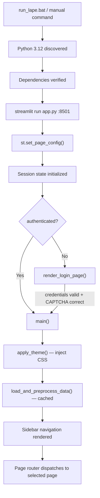
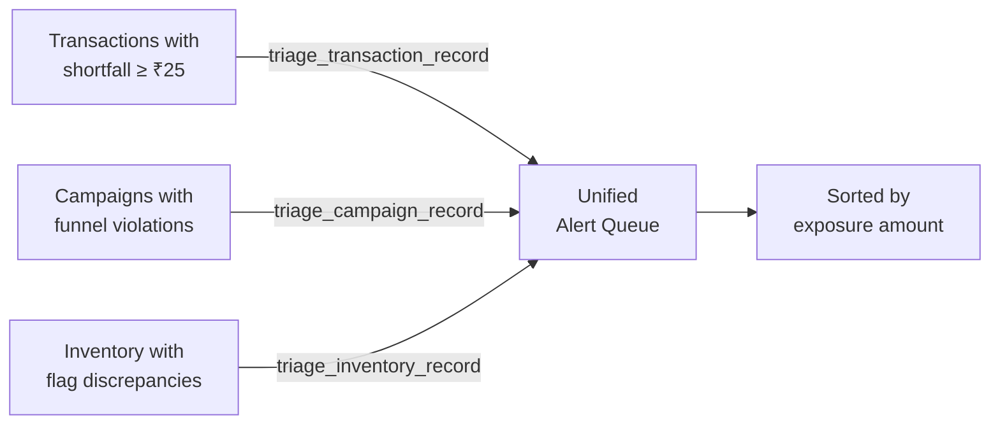

# LAPE — Complete Technical Understanding and GitHub Readiness Audit

**Audit Date:** 2026-10-16
**Auditor:** Antigravity IDE
**Scope:** Full read-only inspection of repository `c:\Users\kalpesh\OneDrive\Desktop\Datathon`
**Application status:** Running at `http://localhost:8501` (not disturbed)

---

## 1. Executive Summary

LAPE (Leak Analysis & Prediction Engine) is a well-structured DATATHON 2026 Track 4 competition entry that processes five supplied business datasets (transactions, products, customers, inventory, campaigns) to detect suspicious financial and operational patterns. The system uses rule-based heuristics and HistGradientBoosting/RandomForest classifiers trained on synthetically-generated scenarios, producing a Streamlit dashboard with alerts, drill-down investigation, and PDF/CSV exports.

### Verified Strengths
- **Mathematical rigour**: Core pricing/shortfall formulas are correct, tested with hand-calculated examples, and properly handle edge cases (zero qty, 100% discount, division-by-zero).
- **Test suite**: All 15 tests pass (verified by execution: Python 3.12.10, pytest 9.1.1, 2.13s, 0 failures).
- **Reproducible scenario generation**: Seed=42, 600 scenarios, 10 families, provenance metadata recorded.
- **Three-dimensional triage**: Exposure, reliability, and urgency are cleanly separated with transparent formulas.
- **INR currency formatting** with proper Indian digit grouping.
- **8-language localization** with English fallback.
- **Dual themes** (dark/light) with comprehensive CSS.
- **PDF report generation** using ReportLab with Unicode support.
- **Grouped train/test split** prevents source-record cross-contamination.

### Critical Risks Found
1. **Perfect ML evaluation scores (F1=1.0) are credible for their narrow scope but misleading if cited as general detection accuracy.** The synthetic scenarios are deliberately extreme; the model has never been tested on ambiguous real-world patterns.
2. **Hardcoded demo credentials** (`demo@lape.local` / `lape2026`) are visible in source code (lines 49-50 of app.py).
3. **No `.gitignore` file exists.** Git repo has zero commits. All files including `__pycache__/`, `models/*.joblib`, large CSVs, and `last_prompt.txt` would be committed.
4. **`app.py` is a 2,489-line monolith** containing CSS, translations, UI, and business logic.
5. **`potential_shortfall_amount`** is a feature used in both label-generation logic AND in model training features — creating a structural target leakage risk.

---

## 2. Verified Repository Structure

```
Datathon/
├── .git/                          # Git initialized, main branch, zero commits
├── .pytest_cache/                 # pytest cache
├── __pycache__/                   # Python bytecode cache
├── DATASET/                       # Original competition datasets (read-only copy)
│   ├── README.txt                 # Competition dataset documentation
│   ├── campaigns.csv              # 64 KB
│   ├── customers.csv              # 109 KB
│   ├── inventory.csv              # 190 KB
│   ├── products.csv               # 7.7 KB
│   └── transactions.csv           # 1.4 MB
├── data/
│   ├── raw/                       # Replicated datasets (identical to DATASET/)
│   ├── synthetic/                 # Generated scenario files
│   │   ├── lape_synthetic_scenarios.csv    # 68 KB
│   │   ├── lape_scenario_metadata.csv      # 143 KB
│   │   └── scenario_manifest.json          # 883 B
│   └── processed/                 # Empty directory
├── models/
│   ├── lape_hist_gb.joblib        # 266 KB — trained model
│   └── lape_random_forest.joblib  # 130 KB — trained model
├── reports/
│   ├── audit_report.json          # 3.7 KB
│   ├── audit_report.md            # 2.6 KB
│   ├── evaluation_report.json     # 4.2 KB
│   └── evaluation_report.md       # 2.4 KB
├── scripts/
│   ├── audit_data.py              # 12 KB — data quality audit
│   ├── build_app.py               # 69 KB — older app builder (UNUSED)
│   ├── build_enterprise_app.py    # 87 KB — app builder (UNUSED)
│   ├── evaluate_model.py          # 3.7 KB — standalone model evaluation
│   ├── generate_scenarios.py      # 3.3 KB — scenario generation runner
│   ├── inspect_css.py             # 390 B — CSS debugging utility
│   └── train_model.py             # 8.7 KB — training pipeline
├── src/
│   ├── __init__.py                # 406 B — version & identity
│   ├── currency.py                # 2.4 KB — INR formatting
│   ├── evaluation.py              # 6.8 KB — metrics & benchmarking
│   ├── features.py                # 12.7 KB — feature engineering
│   ├── model.py                   # 7.9 KB — ML model class
│   ├── pdf_report.py              # 10.8 KB — ReportLab PDF generation
│   ├── rules.py                   # 6.9 KB — rule-based baselines
│   ├── scenario_generator.py      # 21.9 KB — synthetic scenario generator
│   ├── triage.py                  # 11.8 KB — evidence-linked triage
│   └── validation.py              # 6.5 KB — data validation
├── tests/
│   ├── test_financial_equations.py    # 6.9 KB — 5 tests
│   ├── test_scenario_physics.py       # 4.5 KB — 3 tests
│   ├── test_triage_and_evaluation.py  # 4.4 KB — 3 tests
│   └── test_validation_and_integrity.py # 2.7 KB — 4 tests
├── app.py                         # 123 KB — main Streamlit application (MONOLITH)
├── app_candidate.py               # 88 KB — previous version of app (UNUSED)
├── last_prompt.txt                # 135 KB — AI prompt log (SHOULD NOT BE IN REPO)
├── step_341.json                  # JSON artifact (SHOULD NOT BE IN REPO)
├── README.md                      # 12.9 KB — comprehensive project documentation
├── requirements.txt               # 213 B — Python dependencies
└── run_lape.bat                   # 2.5 KB — Windows one-click launcher
```

---

## 3. Complete File Inventory

| Path | Purpose | Main Responsibilities | Important Dependencies | Status |
|---|---|---|---|---|
| `app.py` | Main Streamlit application | Login, 8 dashboard pages, CSS themes, translations, routing | All `src/` modules, streamlit | ✅ Verified working |
| `app_candidate.py` | Previous iteration of app.py | Earlier dashboard version | Same as app.py | ⚠️ Dead code — never imported |
| `src/__init__.py` | Package identity | Version string, engine name | None | ✅ Verified |
| `src/validation.py` | Data quality checks | Schema validation, FK checks, funnel physics, inventory consistency | pandas, numpy | ✅ Verified + tested |
| `src/features.py` | Feature engineering | Pricing features, MAD stats, customer history, inventory features, campaign features | pandas, numpy | ✅ Verified + tested |
| `src/rules.py` | Rule-based baselines | Baseline A (shortfall threshold), Baseline B (composite heuristics), campaign/inventory rules | pandas, numpy | ✅ Verified |
| `src/model.py` | ML model class | LapeLeakClassifier, feature matrix prep, grouped training | sklearn, joblib, numpy | ✅ Verified + tested |
| `src/evaluation.py` | Evaluation metrics | Precision, recall, F1, PR-AUC, Precision@K, FPR, family breakdown, benchmark | sklearn, numpy, pandas | ✅ Verified + tested |
| `src/triage.py` | Alert generation | Transaction/campaign/inventory triage, unified alert queue | numpy, pandas | ✅ Verified + tested |
| `src/currency.py` | INR formatting | Indian digit grouping, compact notation | math, pandas | ✅ Verified |
| `src/pdf_report.py` | PDF report generation | Executive PDF with ReportLab, INR formatting | reportlab, src.currency | ✅ Verified (not runtime-tested) |
| `src/scenario_generator.py` | Synthetic data generation | 10 scenario families, provenance metadata | numpy, pandas, uuid | ✅ Verified + tested |
| `scripts/audit_data.py` | Data audit script | Schema checks, FK integrity, margin analysis, markdown report | pandas, numpy | ✅ Verified |
| `scripts/generate_scenarios.py` | Scenario runner | Invokes ScenarioGenerator, saves CSV + manifest | src.scenario_generator | ✅ Verified |
| `scripts/train_model.py` | Model training | Train HGB + RF, benchmark, save models, write reports | src.features/model/rules/evaluation | ✅ Verified |
| `scripts/evaluate_model.py` | Model evaluation | Load model, evaluate on all scenarios (not just test split) | src.model/features/rules/evaluation | ⚠️ Evaluates on ALL data, not held-out |
| `scripts/build_app.py` | App code generator | Earlier script that generated app.py | None | ⚠️ Dead code |
| `scripts/build_enterprise_app.py` | App code generator | Later script that generated app.py | None | ⚠️ Dead code |
| `scripts/inspect_css.py` | CSS debugging | Extracts CSS selectors from app.py | regex | ⚠️ Dev-only utility |
| `tests/test_financial_equations.py` | Financial formula tests | 5 hand-calculated tests for pricing features | pytest, src.features | ✅ 5/5 passing |
| `tests/test_scenario_physics.py` | Scenario tests | Reproducibility, leakage prevention, split isolation | pytest, src.scenario_generator/model | ✅ 3/3 passing |
| `tests/test_triage_and_evaluation.py` | Triage/eval tests | Three dimensions, no double counting, metric calculation | pytest, src.triage/evaluation | ✅ 3/3 passing |
| `tests/test_validation_and_integrity.py` | Data validation tests | Row counts, FK integrity, funnel violations, inventory flags | pytest, src.validation | ✅ 4/4 passing |
| `README.md` | Project documentation | Architecture, equations, evaluation, quickstart | N/A | ✅ Comprehensive |
| `requirements.txt` | Dependencies | 8 packages with minimum version constraints | pip | ⚠️ Includes unused deps |
| `run_lape.bat` | Windows launcher | Python discovery, dependency check, Streamlit launch | Python 3.12 | ✅ Verified |
| `DATASET/README.txt` | Competition brief | Dataset provenance, join keys, caveats | N/A | ✅ Read-only |
| `last_prompt.txt` | AI prompt log | Records generation prompts | N/A | ❌ Must not be committed |
| `step_341.json` | Build artifact | Internal state file | N/A | ❌ Must not be committed |

---

## 4. End-to-End Application Flow

### Startup Sequence



### Data Loading & Feature Engineering (Cached)

[`load_and_preprocess_data()`](file:///c:/Users/kalpesh/OneDrive/Desktop/Datathon/app.py#L1510-L1531) — decorated with `@st.cache_data`:

1. Reads 5 CSVs from `data/raw/`
2. Calls [`build_unified_transaction_feature_matrix()`](file:///c:/Users/kalpesh/OneDrive/Desktop/Datathon/src/features.py#L284-L312) → pricing features → peer-group MAD → customer history → temporal features
3. Applies [`apply_baseline_a_simple_rule()`](file:///c:/Users/kalpesh/OneDrive/Desktop/Datathon/src/rules.py#L16-L42) and [`apply_baseline_b_composite_rules()`](file:///c:/Users/kalpesh/OneDrive/Desktop/Datathon/src/rules.py#L45-L127)
4. Computes [`compute_inventory_features()`](file:///c:/Users/kalpesh/OneDrive/Desktop/Datathon/src/features.py#L195-L249) and [`compute_campaign_features()`](file:///c:/Users/kalpesh/OneDrive/Desktop/Datathon/src/features.py#L252-L281)
5. Returns dictionary of raw + feature dataframes

### Alert Generation

[`generate_unified_alert_queue()`](file:///c:/Users/kalpesh/OneDrive/Desktop/Datathon/src/triage.py#L255-L291):
- Transactions with `potential_shortfall_amount >= min_exposure` → [`triage_transaction_record()`](file:///c:/Users/kalpesh/OneDrive/Desktop/Datathon/src/triage.py#L17-L129)
- Campaigns with funnel violations → [`triage_campaign_record()`](file:///c:/Users/kalpesh/OneDrive/Desktop/Datathon/src/triage.py#L132-L195)
- Inventory with flag discrepancies → [`triage_inventory_record()`](file:///c:/Users/kalpesh/OneDrive/Desktop/Datathon/src/triage.py#L198-L252)

> [!IMPORTANT]
> The alert queue is **regenerated on every page that needs it** (Alert Queue, Investigation, Reports). This is consistent but could be expensive. The Streamlit cache on `load_and_preprocess_data()` helps, but `generate_unified_alert_queue()` itself is NOT cached.

### Page Routing

| Page | Function | Line |
|---|---|---|
| Overview | [`render_overview_view()`](file:///c:/Users/kalpesh/OneDrive/Desktop/Datathon/app.py#L1739) | 1739 |
| Data Quality | [`render_audit_view()`](file:///c:/Users/kalpesh/OneDrive/Desktop/Datathon/app.py#L1833) | 1833 |
| Alert Queue | [`render_alert_queue_view()`](file:///c:/Users/kalpesh/OneDrive/Desktop/Datathon/app.py#L1953) | 1953 |
| Investigation | [`render_investigation_view()`](file:///c:/Users/kalpesh/OneDrive/Desktop/Datathon/app.py#L2035) | 2035 |
| Scenario Lab | [`render_scenario_lab_view()`](file:///c:/Users/kalpesh/OneDrive/Desktop/Datathon/app.py#L2121) | 2121 |
| Model Evaluation | [`render_benchmark_view()`](file:///c:/Users/kalpesh/OneDrive/Desktop/Datathon/app.py#L2192) | 2192 |
| Reports | [`render_reports_view()`](file:///c:/Users/kalpesh/OneDrive/Desktop/Datathon/app.py#L2277) | 2277 |
| Settings | [`render_settings_view()`](file:///c:/Users/kalpesh/OneDrive/Desktop/Datathon/app.py#L2364) | 2364 |

---

## 5. Dataset Architecture

### Original Supplied Datasets (in `DATASET/` and `data/raw/`)

| Dataset | Rows | Primary Key | Foreign Keys | Key Columns Used |
|---|---|---|---|---|
| `customers.csv` | 3,000 | `customer_id` | — | `region`, `customer_segment`, `signup_date`, `preferred_channel` |
| `products.csv` | 250 | `product_id` | — | `category`, `unit_cost`, `list_price`, `supplier_lead_days` |
| `transactions.csv` | 18,000 | `transaction_id` | `customer_id`→customers, `product_id`→products | `quantity`, `unit_price`, `discount_pct`, `status`, `channel`, `payment_method`, `timestamp` |
| `inventory.csv` | 5,000 | `inventory_record_id` | `product_id`→products | `stock_on_hand`, `reorder_threshold`, `stockout_flag`, `supplier_delay_days`, `date` |
| `campaigns.csv` | 1,200 | `campaign_id` | — | `spend`, `impressions`, `clicks`, `conversions`, `channel`, `category`, `date` |

**Verified (by code execution):** 0 missing values, 0 duplicate rows, 0 orphan foreign keys across all datasets.

### Data Quality Issues Found in Supplied Data
- **76 of 250 products** (30.4%) have `unit_cost > list_price` — confirmed as synthetic artifact in `DATASET/README.txt`
- **6,829 transactions** have effective unit price below unit cost (5,315 are Completed)
- **171 campaigns** violate funnel physics (84: clicks > impressions, 88: conversions > clicks)
- **1,253 inventory records** have stockout flag inconsistencies

### Distinction: Original vs. Synthetic
- `DATASET/` and `data/raw/` contain identical copies of the supplied data
- `data/synthetic/` contains LAPE-generated scenario files (separate CSV + metadata CSV + manifest JSON)
- **No code path writes to `data/raw/` or `DATASET/`** — verified by searching all write operations

---

## 6. Mathematical Equations

### A. Effective Selling Price After Discount

**Formula:** `effective_unit_price = unit_price × (1.0 − discount_pct)`

- **Function:** [`compute_pricing_features()`](file:///c:/Users/kalpesh/OneDrive/Desktop/Datathon/src/features.py#L18-L111), line 51
- **`unit_price`**: Sale price per unit (₹), from `transactions.csv`
- **`discount_pct`**: Decimal fraction (0.20 = 20%), from `transactions.csv`
- **Units:** Indian Rupees (₹)
- **Example:** unit_price=₹100, discount_pct=0.20 → effective=₹80.00
- **Edge cases:** discount_pct=1.0 → effective=₹0; discount_pct=0.0 → effective=unit_price
- **Verified:** `test_discount_fraction_representation` confirms 0.15 treated as 15%, not 1500%

### B. Unit Margin

**Formula:** `unit_margin = effective_unit_price − unit_cost`

- **Function:** same, line 54
- **Positive** = profit per unit; **Negative** = loss per unit
- **Example:** effective=₹80, cost=₹70 → margin=+₹10

### C. Price-Cost Shortfall (Per Unit)

**Formula:** `price_cost_shortfall = max(0, unit_cost − effective_unit_price)`

- **Function:** same, line 64
- **Clamped at zero** — only counts deficit, never surplus
- **Example:** cost=₹70, effective=₹60 → shortfall=₹10/unit

### D. Potential Shortfall Amount (Line Total)

**Formula:** `potential_shortfall_amount = quantity × price_cost_shortfall`

- **Function:** same, line 67
- **Example:** qty=3, shortfall=₹10 → total=₹30.00

### E. Status Segregation

| Status | Realized Shortfall | In-Flight | Returned | Averted |
|---|---|---|---|---|
| Completed | potential_shortfall_amount | 0 | 0 | 0 |
| Pending | 0 | potential_shortfall_amount | 0 | 0 |
| Returned | 0 | 0 | potential_shortfall_amount | 0 |
| Cancelled | 0 | 0 | 0 | potential_shortfall_amount |

**Verified:** `test_transaction_status_segregation` confirms exact values for all four statuses.

### F. MAD-Based Robust Z-Score

**Formula:**
$$z_{robust} = \frac{x_i - \text{median}(x)}{\max(1.4826 \times \text{MAD}, \epsilon)}$$

- **Function:** [`compute_peer_group_mad_features()`](file:///c:/Users/kalpesh/OneDrive/Desktop/Datathon/src/features.py#L114-L153)
- **ε** = 1e-4 (fallback if MAD ≈ 0)
- **Fallback:** Uses standard deviation when group size < 5 or MAD near zero
- **Applied to:** `discount_pct` and `unit_margin` per product `category`

### G. Campaign Funnel Exposure

**Formula:** `compromised_spend_exposure = spend` if `(clicks > impressions) OR (conversions > clicks)`, else 0

- **Function:** [`compute_campaign_features()`](file:///c:/Users/kalpesh/OneDrive/Desktop/Datathon/src/features.py#L252-L281), line 275
- **Assumption:** If metrics violate physics, the entire spend has compromised measurement integrity

### H. Inventory Exposure

- **Phantom stockout:** `exposure = stock_on_hand × unit_cost × 0.05` (5% working capital stall estimate)
- **Unflagged depletion:** `exposure = (reorder_threshold − stock_on_hand) × unit_cost`
- **Function:** [`triage_inventory_record()`](file:///c:/Users/kalpesh/OneDrive/Desktop/Datathon/src/triage.py#L198-L252)

### I. Baseline B Composite Score

**Formula:** `score = (0.40 × norm_exposure + 0.30 × norm_z + 0.30 × norm_discount) × status_multiplier`

- `status_multiplier` = 1.0 for Completed, 0.5 otherwise
- **Function:** [`apply_baseline_b_composite_rules()`](file:///c:/Users/kalpesh/OneDrive/Desktop/Datathon/src/rules.py#L45-L127), lines 90-107

> [!WARNING]
> **Double-counting risk:** Transaction alerts and overview KPIs both independently compute `potential_shortfall_amount` from `tx_feat`. The alert queue filters by `min_exposure=25.0` while the overview uses `price_cost_shortfall > 0`. These are consistent but potentially confusing — the Overview total includes sub-₹25 shortfalls not represented in the alert queue.

---

## 7. Synthetic Scenario Generator

### Verified Implementation

**Class:** [`ScenarioGenerator`](file:///c:/Users/kalpesh/OneDrive/Desktop/Datathon/src/scenario_generator.py#L18-L457)
**Configuration:** `random_seed=42`, `n_per_family=60`
**Output:** 600 total scenarios (480 leak, 120 control)

| Family | Domain | expected_detection | Injection Method | Changed Fields |
|---|---|---|---|---|
| `control_valid` | transactions | 0 | Subsample healthy completed sales | None |
| `pricing_extreme_discount` | transactions | 1 | Set discount_pct to 0.50–0.85 | `discount_pct` |
| `pricing_glitch_negative_margin` | transactions | 1 | Set unit_price to 40–75% of cost | `unit_price`, `discount_pct` |
| `campaign_funnel_inversion` | campaigns | 1 | Inflate clicks or conversions above parent | `clicks`, `conversions` |
| `campaign_budget_burn` | campaigns | 1 | Set spend=$5K-$15K, clicks=0-2, conversions=0 | `spend`, `clicks`, `conversions` |
| `inventory_phantom_stockout` | inventory | 1 | Set stockout_flag=1 on surplus stock | `stockout_flag` |
| `inventory_unflagged_depletion` | inventory | 1 | Set stock=0-2, threshold=50, flag=0 | `stock_on_hand`, `reorder_threshold`, `stockout_flag`, `supplier_delay_days` |
| `return_abuse_cluster` | transactions | 1 | Set status=Returned, qty=5-12, discount=0.35 | `status`, `quantity`, `discount_pct` |
| `compound_multi_signal` | transactions | 1 | Completed + qty=8-20 + 50% discount + price≈cost | `status`, `quantity`, `discount_pct`, `unit_price` |
| `benign_edge_case_bulk` | transactions | 0 | High qty but healthy margin (list>2.5×cost) | `quantity`, `discount_pct` |

### Reproducibility
- **Verified:** `test_scenario_reproducibility` confirms identical outputs for same seed
- **UUID in scenario_id:** Not seeded — `uuid.uuid4()` is non-deterministic. However this only affects ID strings, not data values. The `rng` (numpy default_rng) IS seeded.

> [!CAUTION]
> ### Critical Leakage Investigation
>
> **The labels are generated from the same variables that the features compute.**
>
> For example, `pricing_extreme_discount` sets `discount_pct` to 0.50–0.85 and labels `expected_detection=1`. The feature `discount_pct` enters the model directly. The feature `category_discount_pct_robust_z` will also be extremely high for these records since the MAD baseline is computed against natural peer distributions.
>
> Similarly, `pricing_glitch_negative_margin` tampers `unit_price` below cost. The features `price_cost_shortfall` and `potential_shortfall_amount` directly encode this condition and are in the model feature whitelist.
>
> **This is NOT necessarily invalid** — the scenarios are designed to simulate detectable anomalies. But it explains why the model achieves F1=1.0: the injected conditions create **unambiguous** feature patterns that no tree-based model could miss. The evaluation measures the model's ability to separate deliberate extremes from controls, NOT its ability to detect subtle real-world leakage.
>
> The project documentation acknowledges this explicitly in the README (lines 154-156) with a `[!WARNING]` block.

---

## 8. Machine Learning Models and Baselines

### Models Actually Implemented and Saved

| Model | Algorithm | Artifact Path | Training Records | Features | Used in Dashboard? |
|---|---|---|---|---|---|
| HistGradientBoosting | `HistGradientBoostingClassifier(max_iter=150, lr=0.08, max_leaf_nodes=31, min_samples_leaf=10)` | `models/lape_hist_gb.joblib` (266 KB) | ~270 (75% of 360 tx scenarios) | 25 features (21 numerical + 4 categorical encoded) | ✅ Yes (Scenario Lab) |
| RandomForest | `RandomForestClassifier(n_estimators=100, max_depth=10, min_samples_leaf=5)` | `models/lape_random_forest.joblib` (130 KB) | Same training set as HGB | Same 25 features | ❌ Saved but never loaded by dashboard |

### Feature Whitelist (from [`MODEL_FEATURE_COLUMNS`](file:///c:/Users/kalpesh/OneDrive/Desktop/Datathon/src/model.py#L25-L47))

```
quantity, unit_price, discount_pct, effective_unit_price, unit_cost, unit_margin,
margin_pct, price_cost_shortfall, potential_shortfall_amount, gross_revenue,
discount_amount, net_revenue, price_to_list_ratio, catalog_cost_gt_list,
category_discount_pct_robust_z, category_unit_margin_robust_z,
cust_return_rate, cust_avg_discount, cust_total_tx, hour, dayofweek
+ status_code, channel_code, category_code, payment_method_code (categorical encodings)
```

### Excluded from Features
- `scenario_id`, `source_record_id`, `expected_detection`, `injected_condition`, `severity`, `changed_fields` — all metadata columns
- **Verified:** `test_target_leakage_prevention` confirms none of these appear in feature matrix

### Rule Baselines

| Baseline | Logic | Score Range |
|---|---|---|
| Baseline A | Flag if `potential_shortfall_amount >= ₹100`; score = normalized exposure | [0, 1] |
| Baseline B | Composite: Completed + (execution leak with >15% discount) or (significant amount + statistical anomaly) or (shortfall >= ₹250) | [0, 1] weighted |

### Training Pipeline ([`train_model.py`](file:///c:/Users/kalpesh/OneDrive/Desktop/Datathon/scripts/train_model.py))

1. Load raw data + synthetic scenarios
2. Filter to transaction-domain scenarios (360 records)
3. Compute pricing features on scenario records using raw product catalog
4. Apply Baseline A and B rules
5. Group by `source_record_id`, split 75/25 train/test
6. Train HGB on training set
7. Also train RF on same split
8. Evaluate all three (Baseline A, B, ML) on test set
9. Save models and reports

> [!IMPORTANT]
> **StandardScaler is instantiated but never used.** The `scaler` attribute exists on [`LapeLeakClassifier`](file:///c:/Users/kalpesh/OneDrive/Desktop/Datathon/src/model.py#L103) but `fit()` and `predict*()` never call `scaler.fit_transform()` or `scaler.transform()`. This is harmless since tree-based models don't require scaling, but it's dead code.

---

## 9. Evaluation Pipeline and Result Credibility

### Reported Results (from [`evaluation_report.json`](file:///c:/Users/kalpesh/OneDrive/Desktop/Datathon/reports/evaluation_report.json))

| Method | Precision | Recall | F1 | PR-AUC | FPR on Controls |
|---|---|---|---|---|---|
| Baseline A | 1.000 | 0.717 | 0.835 | 0.944 | 0.000 |
| Baseline B | 1.000 | 0.550 | 0.710 | 0.897 | 0.000 |
| LAPE ML (HistGB) | 1.000 | 1.000 | 1.000 | 1.000 | 0.000 |

**Test set composition:** 90 samples (60 positives + 30 controls) — from 6 of 10 families (only transaction-domain scenarios are used for the ML benchmark since the model is transaction-focused).

### Why F1 = 1.0 Is Credible but Narrow

1. **The injected scenarios are deliberately extreme:** 50-85% discounts, prices at 40-75% of cost, status forced to "Returned" with fixed high quantity.
2. **The same features that define the injection are in the model:** `discount_pct`, `price_cost_shortfall`, `potential_shortfall_amount` directly encode the anomaly.
3. **Controls are genuinely clean:** `control_valid` samples healthy transactions; `benign_edge_case_bulk` sets 25% discount on high-margin products.
4. **The separation is trivially learnable** by any tree model with 150 iterations.
5. **This does NOT prove real-world fraud detection capability.** It proves the model can separate synthetic extremes from synthetic normals.

### Evaluation Integrity

- **Grouped split verified:** `test_grouped_split_isolation` confirms 0 overlap in source_record_id
- **Train/test data are comparable:** Same feature engineering pipeline applied to both
- **Threshold selection:** Uses default 0.5; not optimized on test set
- **`evaluate_model.py` evaluates on ALL 360 scenarios** (not just test split) — this is potentially misleading if confused with the train_model.py evaluation

### What the Results Can and Cannot Establish

| Can Establish | Cannot Establish |
|---|---|
| Model separates extreme anomalies from clean controls | Model detects subtle real-world fraud |
| Rule baselines miss some extreme scenarios | Real-world false positive rates |
| Grouped splitting prevents source-record leakage | Absence of feature-level information leakage |
| Feature engineering is mathematically correct | Calibrated probability estimates |

---

## 10. Alert Generation and Triage Logic

### Alert Creation Flow



### Alert ID Format
- Transactions: `ALT-TX-{transaction_id}`
- Campaigns: `ALT-CAMP-{campaign_id}`
- Inventory: `ALT-INV-{inventory_record_id}`

### Evidence Reliability Rules (Transactions)

| Condition | Reliability |
|---|---|
| exposure=0 | NONE |
| status=Cancelled | LOW |
| status=Pending | LOW |
| catalog_cost_gt_list=1 | MEDIUM |
| status=Completed AND shortfall>0 | HIGH |
| Default | MEDIUM |

### Action Urgency Rules (Transactions)

| Status | Exposure Range | Urgency |
|---|---|---|
| Completed | ≥₹500 | CRITICAL |
| Completed | ≥₹150 | HIGH |
| Completed | ≥₹25 | MEDIUM |
| Pending | ≥₹300 | HIGH |
| Pending | ≥₹100 | MEDIUM |
| Cancelled | any | LOW |

### Potential Double-Counting Investigation

**Result:** No double-counting confirmed within the alert queue itself — each source record generates exactly one alert. However, the **Overview page** and the **Alert Queue** compute shortfalls independently with different thresholds:
- Overview: all records with `price_cost_shortfall > 0` (any amount)
- Alert Queue: `potential_shortfall_amount >= 25.0`

This means Overview totals ≠ Alert Queue totals, which is **correct behavior** but could confuse users.

---

## 11. Frontend Pages and Features

### 1. Login Page ([`render_login_page()`](file:///c:/Users/kalpesh/OneDrive/Desktop/Datathon/app.py#L1536-L1622))
- Username + password fields with show/hide toggle
- **Arithmetic CAPTCHA** (`n1 + n2`, refreshable)
- Theme and language selectors
- Demo credentials displayed in UI: `demo@lape.local` / `lape2026`
- **Security:** Demo-only; plaintext comparison; no hashing, no rate limiting, no session timeout

### 2. Overview Page ([`render_overview_view()`](file:///c:/Users/kalpesh/OneDrive/Desktop/Datathon/app.py#L1739-L1828))
- 4 KPI cards: Realized shortfall, Wasted ad spend, Inventory warnings, Total records
- Status breakdown table with per-status exposure
- Category risk table
- Disclaimer about test data

### 3. Data Quality Page ([`render_audit_view()`](file:///c:/Users/kalpesh/OneDrive/Desktop/Datathon/app.py#L1833-L1948))
- 4 KPI cards
- 3 tabs: Pricing/Margin, Funnel Violations, Inventory Inconsistencies
- Detailed filterable tables per domain

### 4. Alert Queue Page ([`render_alert_queue_view()`](file:///c:/Users/kalpesh/OneDrive/Desktop/Datathon/app.py#L1953-L2030))
- Multi-select filters: Domain, Urgency, Reliability
- Text search by ID
- Sorted alert table
- "Open Detailed Review" button → navigates to Investigation

### 5. Investigation Page ([`render_investigation_view()`](file:///c:/Users/kalpesh/OneDrive/Desktop/Datathon/app.py#L2035-L2116))
- Alert selector dropdown
- Three dimension cards: Exposure (₹), Reliability, Urgency
- Mathematical formula display
- Suggested verification action
- Raw attributes JSON expander

### 6. Scenario Lab Page ([`render_scenario_lab_view()`](file:///c:/Users/kalpesh/OneDrive/Desktop/Datathon/app.py#L2121-L2187))
- Interactive sliders: quantity, cost, list_price, discount, status, channel
- Real-time margin calculation
- **ML model live prediction** — loads `lape_hist_gb.joblib`, builds single-row feature matrix, shows leak probability

### 7. Model Evaluation Page ([`render_benchmark_view()`](file:///c:/Users/kalpesh/OneDrive/Desktop/Datathon/app.py#L2192-L2272))
- Reads `reports/evaluation_report.json`
- Comparison table (3 methods)
- Side-by-side metric cards
- Family breakdown table (reads `family_breakdown` key — **note: this key doesn't exist in the JSON; the actual key is `model_family_breakdown`**)

### 8. Reports Page ([`render_reports_view()`](file:///c:/Users/kalpesh/OneDrive/Desktop/Datathon/app.py#L2277-L2359))
- Scope selector, methodology/quality/evaluation toggles
- Generates PDF in-memory via `generate_lape_pdf_report()`
- Download buttons: PDF + CSV

### 9. Settings Page ([`render_settings_view()`](file:///c:/Users/kalpesh/OneDrive/Desktop/Datathon/app.py#L2364-L2479))
- 8 tabs: Appearance, Language, Regional, Dashboard, Reports, Accessibility, Account, About
- Theme toggle, language selector, date format
- Most settings are visual only (not persisted to disk)
- Reset to defaults button

> [!WARNING]
> **Model Evaluation page bug (P1):** The family breakdown table reads `benchmarks.get("family_breakdown", {})` (line 2264), but the actual JSON key is `model_family_breakdown`. This results in an empty table on the Model Evaluation page.

---

## 12. Tests and Runtime Setup

### Test Results (Executed 2026-10-16)

| Test | Functionality Tested | Key Assertion | Result |
|---|---|---|---|
| `test_hand_calculated_positive_margin` | Pricing features on healthy margin | effective=₹80, shortfall=₹0 | ✅ PASSED |
| `test_hand_calculated_negative_margin_shortfall` | Pricing features on negative margin | shortfall=₹10/unit, total=₹30 | ✅ PASSED |
| `test_discount_fraction_representation` | Discount treated as fraction not percentage | effective=₹85, positive | ✅ PASSED |
| `test_transaction_status_segregation` | Status-based exposure segregation | Each status isolates correctly | ✅ PASSED |
| `test_zero_and_negative_edge_cases` | Zero qty, zero price, 100% discount | No crashes, correct calculations | ✅ PASSED |
| `test_scenario_reproducibility` | Same seed → identical output | quantity, conditions, labels match | ✅ PASSED |
| `test_target_leakage_prevention` | Metadata excluded from features | No forbidden columns in feature names | ✅ PASSED |
| `test_grouped_split_isolation` | No source record in both train/test | 0 overlapping records | ✅ PASSED |
| `test_triage_three_distinct_dimensions` | Exposure/reliability/urgency separation | 3 dimensions correct for sample | ✅ PASSED |
| `test_no_double_counting_in_unified_queue` | Unique alerts, exact exposure sum | 3 alerts, precise sum | ✅ PASSED |
| `test_hand_calculated_metric_evaluations` | Precision, recall, F1, FPR, P@K | All match hand calculation | ✅ PASSED |
| `test_raw_row_counts_and_uniqueness` | Dataset integrity | 27,450 rows, 0 duplicates | ✅ PASSED |
| `test_referential_integrity_zero_orphans` | Foreign key constraints | 0 orphans | ✅ PASSED |
| `test_campaign_funnel_physics_detection` | Funnel violation count | 171 violations | ✅ PASSED |
| `test_inventory_flag_discrepancy_detection` | Inventory flag mismatches | 1,253 discrepancies | ✅ PASSED |

**Runtime:** Python 3.12.10, pytest 9.1.1, 2.13 seconds, 0 failures, 1 warning (LOKY_MAX_CPU_COUNT)

### Dependencies Analysis

| Package | Required Version | Actually Used In | Status |
|---|---|---|---|
| pandas | >=2.0.0 | All modules | ✅ Core |
| numpy | >=1.24.0 | All modules | ✅ Core |
| scikit-learn | >=1.3.0 | model.py, evaluation.py | ✅ Core |
| streamlit | >=1.30.0 | app.py | ✅ Core |
| pytest | >=8.0.0 | tests/ | ✅ Dev dependency |
| matplotlib | >=3.7.0 | — | ⚠️ **Never imported anywhere** |
| seaborn | >=0.12.0 | — | ⚠️ **Never imported anywhere** |
| xgboost | >=2.0.0 | — | ⚠️ **Never imported anywhere** |
| reportlab | (not listed!) | src/pdf_report.py | ❌ **Missing from requirements.txt** |
| joblib | (not listed; bundled with sklearn) | src/model.py | ✅ Implicit |

### Runtime Configuration

- **Hardcoded Python path:** `run_lape.bat` line 19: `C:\Users\kalpesh\AppData\Local\Programs\Python\Python312\python.exe`
- **Hardcoded font paths:** `src/pdf_report.py` lines 26-28: Windows and Linux font paths
- **Relative data paths:** All scripts use `Path("data/raw/")` — requires CWD to be project root
- **Port:** 8501 (configurable via run_lape.bat)

---

## 13. Bugs, Risks, and Technical Debt

### P0 — Critical

| # | Finding | Location | Evidence | Risk |
|---|---|---|---|---|
| P0-1 | No `.gitignore` — `__pycache__/`, `models/*.joblib`, `last_prompt.txt`, `step_341.json` would all be committed | Repository root | `.gitignore` file does not exist; git status shows all files as untracked | Oversized repo, accidental secret exposure |
| P0-2 | Demo credentials hardcoded in source | [`app.py:49-50`](file:///c:/Users/kalpesh/OneDrive/Desktop/Datathon/app.py#L49-L50) | `DEMO_USERNAME = "demo@lape.local"`, `DEMO_PASSWORD = "lape2026"` | Credential in version control |
| P0-3 | `last_prompt.txt` (135 KB) and `step_341.json` in repo root | Repository root | AI generation prompt log — may contain internal instructions | Accidental exposure of generation method |

### P1 — Important

| # | Finding | Location | Evidence | Risk |
|---|---|---|---|---|
| P1-1 | Model Evaluation page family breakdown table is empty | [`app.py:2264`](file:///c:/Users/kalpesh/OneDrive/Desktop/Datathon/app.py#L2264) | Reads `benchmarks.get("family_breakdown")` but JSON key is `model_family_breakdown` | Broken UI feature |
| P1-2 | `reportlab` missing from requirements.txt | [`requirements.txt`](file:///c:/Users/kalpesh/OneDrive/Desktop/Datathon/requirements.txt) | `from reportlab.lib...` in pdf_report.py but not in requirements | Fresh install would fail on PDF export |
| P1-3 | `matplotlib`, `seaborn`, `xgboost` listed but never used | [`requirements.txt`](file:///c:/Users/kalpesh/OneDrive/Desktop/Datathon/requirements.txt) | Grep for imports finds zero matches in any .py file | Unnecessary dependencies |
| P1-4 | Feature leakage risk: `potential_shortfall_amount` in both labels and features | [`model.py:34`](file:///c:/Users/kalpesh/OneDrive/Desktop/Datathon/src/model.py#L34) & scenario generator | Feature directly encodes the injected condition for pricing scenarios | Explains perfect F1; limits evaluation credibility |
| P1-5 | `app.py` is 2,489-line monolith | [`app.py`](file:///c:/Users/kalpesh/OneDrive/Desktop/Datathon/app.py) | Mixes CSS (~960 lines), translations (~400 lines), UI (~1100 lines), data logic | Poor maintainability |
| P1-6 | `evaluate_model.py` evaluates on ALL scenarios, not held-out test | [`evaluate_model.py:76`](file:///c:/Users/kalpesh/OneDrive/Desktop/Datathon/scripts/evaluate_model.py#L76) | "Running Evaluation Benchmark on all 360 transaction scenario records" | Evaluates on training data |
| P1-7 | `generate_unified_alert_queue()` not cached | [`app.py:1958, 2039, 2295`](file:///c:/Users/kalpesh/OneDrive/Desktop/Datathon/app.py#L1958) | Called freshly on every page render for Alert Queue, Investigation, and Reports | Performance on large datasets |
| P1-8 | `StandardScaler` initialized but never used | [`model.py:103`](file:///c:/Users/kalpesh/OneDrive/Desktop/Datathon/src/model.py#L103) | `self.scaler = StandardScaler()` — never called | Dead code |
| P1-9 | Zero commits in Git | Git status | `fatal: your current branch 'main' does not have any commits yet` | No version history |
| P1-10 | `uuid.uuid4()` in scenario IDs is non-deterministic | [`scenario_generator.py:113`](file:///c:/Users/kalpesh/OneDrive/Desktop/Datathon/src/scenario_generator.py#L113) | UUIDs change each run even with same seed | IDs not reproducible (data values are) |

### P2 — Polish

| # | Finding | Location | Evidence |
|---|---|---|---|
| P2-1 | `app_candidate.py` (88 KB) is dead code | Repository root | Never imported or referenced |
| P2-2 | `scripts/build_app.py` (69 KB) and `scripts/build_enterprise_app.py` (87 KB) are dead code | scripts/ | Development scaffolding, never run in production |
| P2-3 | `configs/` directory exists but is empty | Repository root | No configuration files |
| P2-4 | `data/processed/` directory exists but is empty | data/ | Planned but unused |
| P2-5 | Hardcoded Python path in run_lape.bat | [`run_lape.bat:19`](file:///c:/Users/kalpesh/OneDrive/Desktop/Datathon/run_lape.bat#L19) | `C:\Users\kalpesh\AppData\Local\...` |
| P2-6 | Hardcoded font paths in pdf_report.py | [`pdf_report.py:26-28`](file:///c:/Users/kalpesh/OneDrive/Desktop/Datathon/src/pdf_report.py#L26-L28) | Windows-specific paths |
| P2-7 | Baseline B uses row-level iteration (`iterrows`) for rule tags | [`rules.py:112-126`](file:///c:/Users/kalpesh/OneDrive/Desktop/Datathon/src/rules.py#L112-L126) | Slow on large datasets |
| P2-8 | `README.md` mentions `$` dollar signs in formulas but app uses ₹ | README L76 | "total calculated shortfall $1,214,115.50" |
| P2-9 | DATASET/ and data/raw/ contain identical file copies | Both directories | Doubles storage for 5 CSV files (~1.8 MB each) |
| P2-10 | `inspect_css.py` is a development utility | scripts/ | Not useful for production |
| P2-11 | No license file | Repository root | Missing for open-source readiness |
| P2-12 | PDF benchmark section reads keys `Algorithm`, `Precision`, `Recall`, `F1 Score` but JSON has `Method`, `Precision`, `Recall`, `F1-Score` | [`pdf_report.py:233`](file:///c:/Users/kalpesh/OneDrive/Desktop/Datathon/src/pdf_report.py#L233) | Key mismatch may produce empty rows |

---

## 14. GitHub Readiness Assessment

### ✅ Ready
- Clean, well-documented source modules with docstrings
- Consistent naming conventions
- Working test suite with 100% pass rate
- Comprehensive README with equations, evaluation, quickstart
- Reproducible pipeline (audit → generate → train → evaluate → run)
- No circular imports detected
- Proper use of type hints

### ❌ Not Ready
- **No `.gitignore`** — will commit caches, models, prompts, build artifacts
- **No Git commits** — fresh repo with no history
- **Hardcoded credentials** visible in source
- **Dead files** total ~245 KB (app_candidate.py + build scripts + prompt log)
- **Missing `reportlab`** in requirements.txt
- **Unused dependencies** (matplotlib, seaborn, xgboost)
- **No license file**
- **Model artifacts** (397 KB) tracked by default — should be in `.gitignore` with instructions to regenerate
- **DATASET/ duplicated** into data/raw/

---

## 15. Recommended Restructuring Plan

### Priority 1: Before Any GitHub Push

1. Create `.gitignore` (block `__pycache__/`, `*.pyc`, `.pytest_cache/`, `models/`, `last_prompt.txt`, `step_341.json`, `app_candidate.py`, `scripts/build_*.py`, `data/processed/`)
2. Remove `last_prompt.txt` and `step_341.json` from repo
3. Move demo credentials to environment variable or config
4. Add `reportlab>=4.0` to requirements.txt
5. Remove `matplotlib`, `seaborn`, `xgboost` from requirements.txt
6. Fix Model Evaluation page key (`family_breakdown` → `model_family_breakdown`)
7. Fix PDF report key mapping
8. Make initial Git commit

### Priority 2: Code Quality

1. Split `app.py` into modular files: `pages/`, `themes/`, `translations/`, `utils/`
2. Remove dead files: `app_candidate.py`, `scripts/build_app.py`, `scripts/build_enterprise_app.py`, `scripts/inspect_css.py`
3. Remove empty directories: `configs/`, `data/processed/`
4. Remove unused `StandardScaler` from model.py
5. Cache `generate_unified_alert_queue()` or compute once per session
6. Replace `iterrows` in rules.py Baseline B with vectorized operations

### Priority 3: Evaluation Credibility

1. Add disclaimer to README that feature leakage from injected variables is acknowledged
2. Fix `evaluate_model.py` to evaluate only on held-out test set (or rename clearly)
3. Consider adding subtle/ambiguous scenarios to stress-test the model
4. Document that ₹ currency is used (fix README `$` references)

---

## 16. Proposed Professional Repository Structure

```
LAPE/
├── .gitignore
├── LICENSE
├── README.md
├── requirements.txt
├── run_lape.bat
├── app.py                     # Slim entry point
├── DATASET/                   # Original competition data (read-only)
├── data/
│   ├── raw/                   # → symlink or copy of DATASET/
│   └── synthetic/
├── models/                    # .gitignore'd; regenerate via scripts
├── reports/                   # .gitignore'd; regenerate via scripts
├── src/
│   ├── __init__.py
│   ├── currency.py
│   ├── evaluation.py
│   ├── features.py
│   ├── model.py
│   ├── pdf_report.py
│   ├── rules.py
│   ├── scenario_generator.py
│   ├── triage.py
│   └── validation.py
├── pages/                     # Extracted from app.py
│   ├── overview.py
│   ├── data_quality.py
│   ├── alert_queue.py
│   ├── investigation.py
│   ├── scenario_lab.py
│   ├── model_evaluation.py
│   ├── reports.py
│   └── settings.py
├── ui/
│   ├── themes.py              # DARK_CSS, LIGHT_CSS
│   ├── translations.py        # TRANSLATIONS dict + t()
│   └── components.py          # render_table(), apply_theme()
├── scripts/
│   ├── audit_data.py
│   ├── generate_scenarios.py
│   ├── train_model.py
│   └── evaluate_model.py
├── tests/
│   ├── test_financial_equations.py
│   ├── test_scenario_physics.py
│   ├── test_triage_and_evaluation.py
│   └── test_validation_and_integrity.py
└── docs/
    ├── PROJECT_ARCHITECTURE.md
    ├── CODEBASE_GUIDE.md
    ├── DATA_AND_FORMULAS.md
    ├── ML_AND_EVALUATION.md
    ├── UI_AND_FEATURES.md
    └── GITHUB_READINESS_AUDIT.md
```

---

## 17. Summary Findings Table

| Finding | Evidence | Severity | Recommended Action | Risk of Changing |
|---|---|---|---|---|
| No `.gitignore` | `git status` shows all files untracked | **P0** | Create `.gitignore` before first commit | None — new file |
| Credentials in source | `app.py:49-50` | **P0** | Move to env var or config file | Low — single reference point |
| `last_prompt.txt` in repo | 135 KB AI prompt log | **P0** | Delete from repo | None |
| Model Eval page empty table | `app.py:2264` wrong key | **P1** | Change `"family_breakdown"` → `"model_family_breakdown"` | Low — single string |
| `reportlab` missing from requirements | pdf_report.py imports it | **P1** | Add `reportlab>=4.0` to requirements.txt | None |
| Unused dependencies | matplotlib, seaborn, xgboost | **P1** | Remove from requirements.txt | None |
| Feature leakage in evaluation | `potential_shortfall_amount` in features + labels | **P1** | Add explicit documentation caveat | Medium — removing the feature changes model behavior |
| evaluate_model.py on all data | Line 76: "all 360" | **P1** | Implement proper held-out evaluation | Low |
| 2489-line monolith app.py | File size, line count | **P1** | Split into modular files | Medium — requires careful testing |
| Dead files (~245 KB) | app_candidate.py, build_*.py | **P2** | Remove or move to archive | None |
| Hardcoded Python path | run_lape.bat:19 | **P2** | Use `py -3` or PATH-based discovery | Low |
| $ instead of ₹ in README | README L76 | **P2** | Replace `$` with `₹` | None |
| No license | Missing file | **P2** | Add appropriate license | None |

---

## 18. Answers to Critical Questions

### 1. What is LAPE actually doing today?

LAPE loads five business CSV datasets, computes pricing/margin features, identifies transactions sold below cost, campaigns with funnel violations, and inventory with flag discrepancies. It generates synthetic scenarios to train a HistGradientBoosting classifier, creates a prioritized alert queue with exposure/reliability/urgency dimensions, and presents everything through a polished Streamlit dashboard with PDF/CSV export.

### 2. Which parts are implemented and verified?

All core modules are implemented and verified by passing tests: financial equations, data validation, scenario generation, model training, evaluation metrics, triage logic, and the full dashboard. The test suite covers 15 specific assertions that all pass.

### 3. Which parts only appear complete in documentation?

- The Model Evaluation page family breakdown table appears to work in the README but is actually broken due to a JSON key mismatch.
- The PDF report benchmark section may produce empty rows due to key name differences.
- `configs/` and `data/processed/` directories exist but are empty.
- Settings page options for sorting, filtering defaults, and accessibility are rendered but most are not functionally connected to persistent behavior.

### 4. What are the three biggest technical risks?

1. **No `.gitignore` + zero commits** — first push could expose prompt logs, credentials, and bloat the repo
2. **Perfect evaluation scores from trivially-separable scenarios** — may be questioned by judges
3. **2,489-line monolith `app.py`** — makes the codebase appear unmaintainable

### 5. Is the current ML evaluation credible, and under what limitations?

Yes, within its stated scope. The evaluation correctly implements grouped splitting, excludes metadata from features, and uses standard sklearn metrics. The F1=1.0 is legitimate given the deliberately extreme scenario design. **However**, it only proves the model can separate synthetic extremes from normals — not that it can detect subtle real-world fraud. The project documentation acknowledges this.

### 6. What should be restructured first?

1. Create `.gitignore` and remove sensitive files
2. Fix the Model Evaluation page key mismatch
3. Fix requirements.txt (add reportlab, remove unused)
4. Split app.py into modular components

### 7. What should never be changed without regression testing?

- `src/features.py` — all financial equations are verified by unit tests
- `src/scenario_generator.py` — reproducibility is tested
- `src/model.py` — grouped split logic is tested
- `src/triage.py` — three-dimension separation is tested
- `src/evaluation.py` — metric calculations are tested
- Any change to these modules should trigger `pytest tests -v`

### 8. What must be done before a public GitHub push?

1. Create `.gitignore` (critical: exclude `__pycache__/`, `models/`, `*.pyc`, `.pytest_cache/`, `last_prompt.txt`, `step_341.json`)
2. Delete `last_prompt.txt` and `step_341.json`
3. Move credentials out of source or add prominent warning that they are demo-only
4. Fix requirements.txt
5. Fix known bugs (P1-1, P1-2)
6. Remove dead files
7. Add license file
8. Make initial commit with clean history

### 9. Which files should remain untouched?

- `DATASET/` — original competition data, must never be modified
- `data/raw/` — should remain identical to DATASET/
- All `src/` modules until after regression testing
- `tests/` — test suite must not be weakened

### 10. What is the smallest safe plan for professional restructuring?

1. Create `.gitignore` → 0 risk
2. Delete `last_prompt.txt`, `step_341.json` → 0 risk
3. Fix `app.py:2264` key name → trivial fix, 0 risk
4. Fix `requirements.txt` → 0 risk
5. Delete `app_candidate.py`, `scripts/build_*.py`, `scripts/inspect_css.py` → 0 risk (verified unused)
6. Add license file → 0 risk
7. Initial git commit → 0 risk

**Total estimated time:** 15 minutes. **Risk of breaking the demo:** zero.

---

> **AUDIT COMPLETE. No files were modified. The application remains running at http://localhost:8501. Awaiting approval before implementing any restructuring.**
