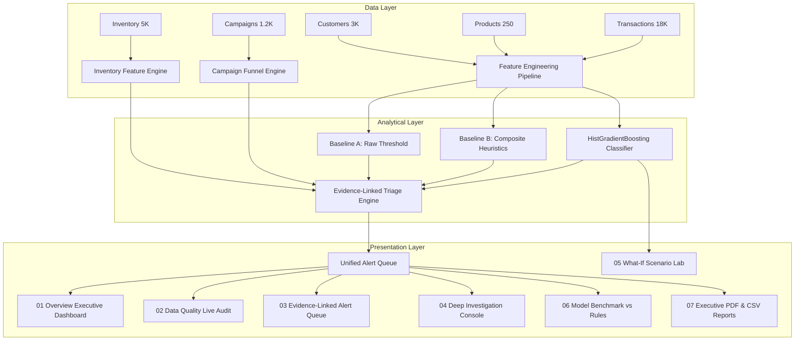

# LAPE Engineering Architecture

## 1. System Vision & Constraints

**LAPE (Leak Analysis & Prediction Engine)** is engineered for **DATATHON 2026 Track 4: The Money Leak**. Its primary mandate is to identify, quantify, explain, and prioritize suspicious financial and operational patterns across business data.

### Three Non-Negotiable Output Dimensions
1. **Potential Financial Exposure**: A transparent, reproducible dollar calculation derived directly from verified source fields.
2. **Evidence Reliability**: Categorized into `HIGH`, `MEDIUM`, or `LOW` based on schema constraints, relational joins, and dataset characteristics.
3. **Action Urgency**: Prioritized into `CRITICAL`, `HIGH`, `MEDIUM`, or `LOW` according to documented business rules rather than opaque probability scores.

## 2. Component Directory Architecture

- **`src/`**: Pure core libraries with zero Streamlit dependencies.
  - `validation.py`: Schema validation, referential integrity verification, funnel physics.
  - `features.py`: Pricing calculations, peer-group MAD z-scores, temporal and customer aggregations.
  - `rules.py`: Transparent baseline heuristics (Baseline A and Baseline B).
  - `scenario_generator.py`: Controlled synthetic scenario generation engine.
  - `model.py`: Model wrappers with target-leakage safeguards and grouped train/test splitting.
  - `evaluation.py`: Precision, recall, PR-AUC, Precision@K, and per-family performance metrics.
  - `triage.py`: Three-dimensional alert generation and calculation provenance.
  - `currency.py`: Indian numbering system formatting (`₹ Lakhs`, `₹ Crores`).
  - `pdf_report.py`: Enterprise PDF generator with ReportLab.

- **`scripts/`**: Automation pipelines for batch operations.
  - `audit_data.py`: CLI data audit and sanity verification.
  - `generate_scenarios.py`: Batch scenario generator producing metadata and synthetic tables.
  - `train_model.py`: End-to-end model training, grouped evaluation, and artifact serialization.
  - `evaluate_model.py`: Model benchmarking script against baselines.

- **`tests/`**: Comprehensive test suite covering equations, scenario physics, triage, and data integrity.
